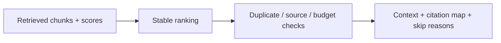

# RAG Context Budgeter

A small offline Python service for the context-assembly stage of retrieval-augmented generation: rank whole chunks, remove repeated text, cap each source and fit the rendered context into an exact UTF-8 byte budget. It does not retrieve documents or call a language model.



## Run

```bash
uv sync --frozen
uv run context-pack examples/request.json
uv run uvicorn context_budgeter.api:app --reload
uv run pytest -q
```

Open http://127.0.0.1:8000/docs. `POST /pack` accepts the example request. `GET /health` checks the process. The CLI writes JSON and exits 0 for a valid request, including an empty selection; malformed input exits 2.

## Packing contract

`available_bytes = max_bytes - reserved_bytes`. The reservation represents caller-owned prompt text; it is subtracted but not included in the returned context. Rank by descending score, then ascending chunk ID. For each chunk, check whether its normalized text was already selected, the source limit was reached, or its full rendered section would exceed the available budget. Keep scanning after an oversized chunk, so smaller lower-ranked chunks can still fit.

Every section uses `[chunk-id] source=source-id`, a newline and stripped chunk text. Sections are separated by two newline bytes. `used_bytes` equals `len(context.encode("utf-8"))`, including headers and separators. No text is truncated. Citation maps describe selected chunk-to-source IDs; they do not verify factual claims in model answers.

Deduplication collapses whitespace and uses Unicode case folding. This intentionally treats case-only differences as duplicates; do not use it when case carries meaning, such as source code. Only selected chunks reserve a fingerprint or source slot. Skipped chunks include a diagnostic reason. Input order does not change output when scores tie. Scores must be finite values from 0 to 1; duplicate IDs, invalid limits and unknown fields are rejected.

## What it does not promise

Bytes are not tokens. The budget does not guarantee an LLM token limit; use the target model's tokenizer when integrating this component into a real pipeline. Greedy score-first packing is deterministic, not an optimal knapsack solver or relevance assessment. Caller-provided scores are not calibrated. Source caps encourage breadth but do not guarantee semantic diversity. The service has no embedding model, retrieval database, answer generation or provenance verification.

Chunk text is untrusted data and may contain malicious instructions or fake citation headers. This packer is not a prompt-injection defense and does not sanitize content. Keep metadata separate in downstream code, use trusted prompt boundaries and independently validate citations. The API has no authentication, rate limit or total HTTP body limit; bind locally and use synthetic documents. The 1000-chunk and per-chunk length bounds are data-validation limits, not a complete memory/DoS defense.

## Container

```bash
docker build -t rag-context-budgeter .
docker run --rm -p 127.0.0.1:8000:8000 rag-context-budgeter
```

Tests cover exact byte boundaries, Unicode, separator costs, reservations, deterministic order, deduplication, source caps, invalid inputs, API and CLI. No paid keys or model downloads are needed.
